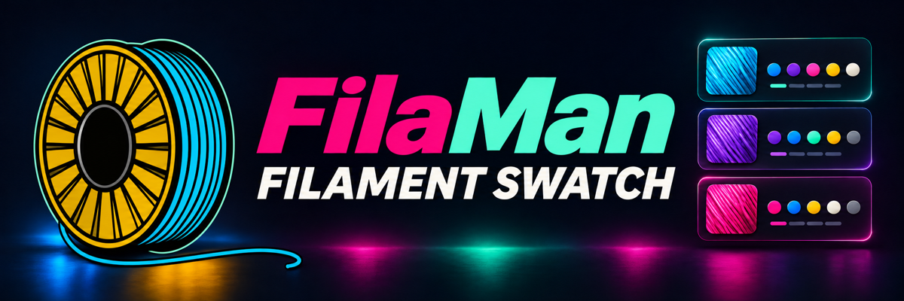
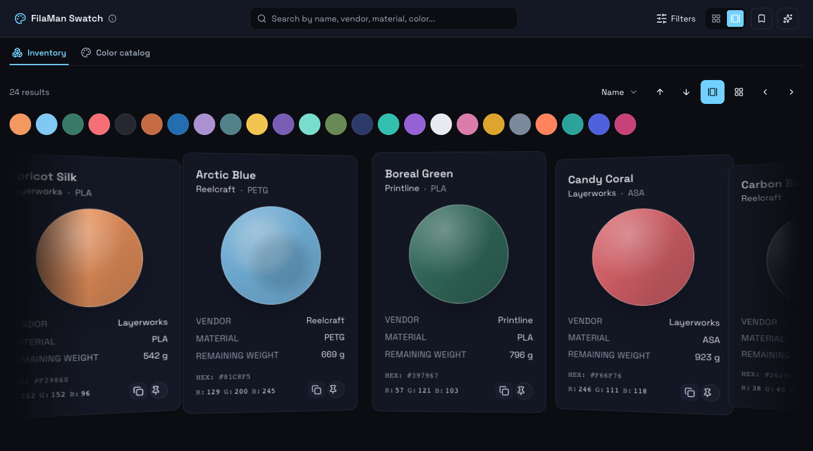
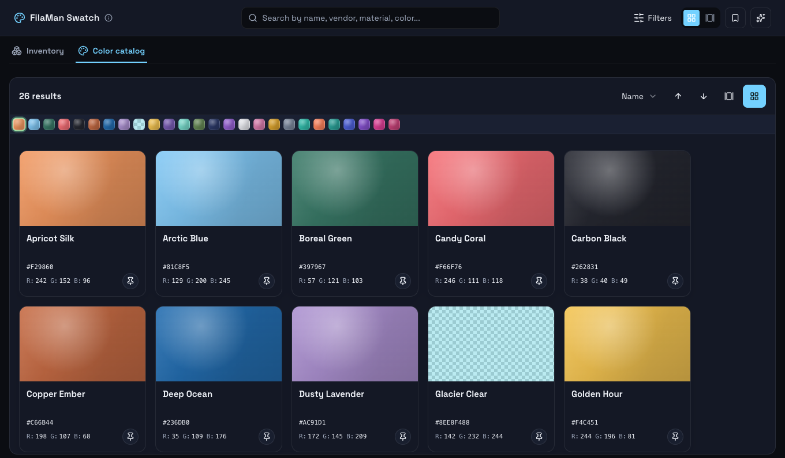
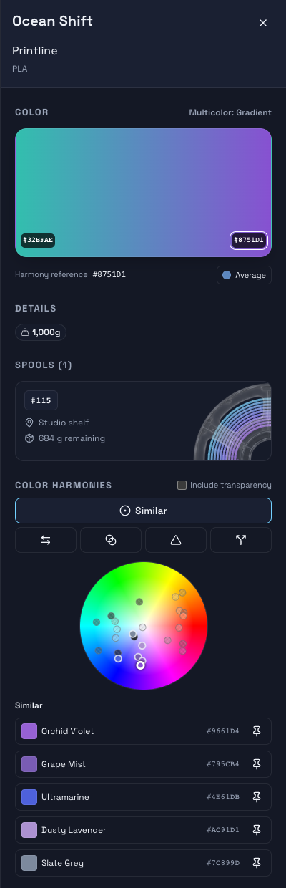

# FilaMan Swatch



FilaMan Swatch is a visual filament browser built into FilaMan. Browse the colors in your inventory, see which spools are on hand, and put together a palette for your next print. Open the matching filament, spool, or color management page in FilaMan to make changes.

## Features

- **Inventory and Color Catalog.** Browse your FilaMan filaments or explore the FilaMan color catalog independently of your stock. Switch between a grid for an overview and a carousel for one swatch at a time.
- **Search and filters.** Search by name, manufacturer, material, or hex code. In Inventory, narrow the results by manufacturer, material, spool location, single or multicolor filament, and on-hand stock. The Swatch URL preserves the active search and filters.
- **Spool details.** See each spool's location and remaining weight when available, then open the spool in FilaMan. Manufacturer logos and reel fill previews appear where available.
- **Color matching.** Read hex and RGB values, see transparency and striped or gradient patterns, and use the interactive Color Harmonies wheel to compare related colors. Swatch uses FilaMan's shared wheel on supported hosts.
- **Pinned palettes.** Pin filaments and catalog colors as you browse, then revisit them together in the palette drawer. Pins are saved for your browser session.
- **FilaMan appearance and language.** The layout adapts to desktop and mobile. Swatch follows FilaMan's theme, language, and currency, with English, German, and French translations.

## Screenshots

All screenshots use sample inventory in FilaMan's dark theme.

### Inventory board


### Inventory carousel



### Color catalog



### Spool details and color selector



## Installation

**FilaMan Swatch 1.1.1 requires a FilaMan build with the hosted SVG installer fix from [PR217](https://github.com/Fire-Devils/filaman-system/pull/217).** FilaMan v2.0.5 includes integration hosting from PR204 but rejects the Swatch ZIP during SVG validation.

1. Download `filament-swatch-1.1.1.zip` from the [1.1.1 release](https://github.com/akira69/filaman-filament-swatch/releases/tag/filaman-v1.1.1).
2. In FilaMan, open **Admin → Plugins** and upload the ZIP.
3. Open **FilaMan Swatch** from the sidebar.

> No SpoolmanAPI plugin or external services required.

## Requirements

- Authenticated same-origin FilaMan endpoints:
  - `/api/v1/filaments`, `/colors`, `/spools`, `/locations`, `/spools/statuses`, `/me`, `/app-settings/public-info`
- All pages must load correctly; duplicate IDs and auth failures are errors.
- Catalog availability is independent of inventory.

See [compatibility docs](docs/filaman-compatibility.md) for full API details.

## Development

### Setup

```bash
npm ci
```

### Run Dev Server

```bash
FILAMAN_DEV_URL=http://127.0.0.1:8087 \
VITE_HOSTED_MODE=1 \
VITE_BASE_PATH=/plugins/filament-swatch/ \
npm run dev
```

Open in browser:

```
/plugins/filament-swatch/app/swatch?filaman_hosted=1&filaman_hosted_config=/plugins/filament-swatch/hosted-config
```

### Build & Test

```bash
VITE_HOSTED_MODE=1 VITE_BASE_PATH=/plugins/filament-swatch/ npm run build
npm test
# Python environment needs FastAPI and httpx
python -m unittest discover -s tests
```

## Packaging

Release tag must match bundled notes:

```bash
python scripts/package-filaman-plugin.py filaman-v1.1.1
```

## Upstream Updates

- Review PRs manually; never auto-merge.
- Conflicts and adoption require manual reconciliation.
- MIT license and attribution retained.

---

**License**: [MIT](LICENSE)
**Original Project**: [Disane87/spoolman-filament-swatch](https://github.com/Disane87/spoolman-filament-swatch)
**Fork**: [akira69/filaman-filament-swatch](https://github.com/akira69/filaman-filament-swatch)
